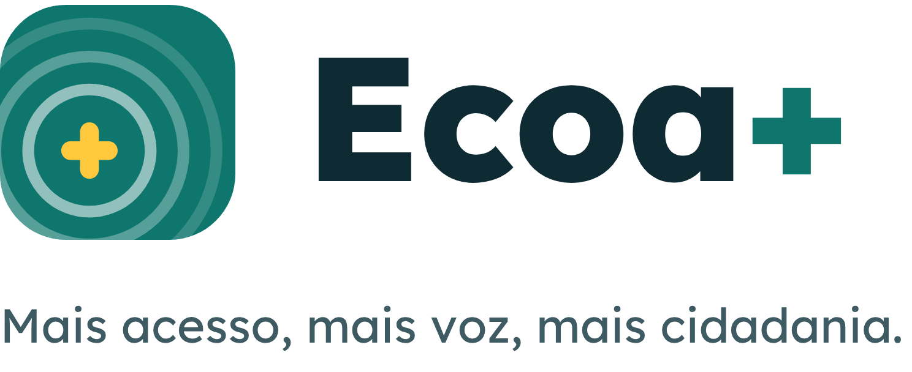
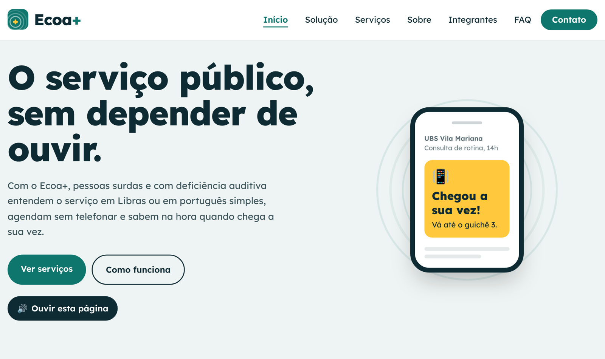
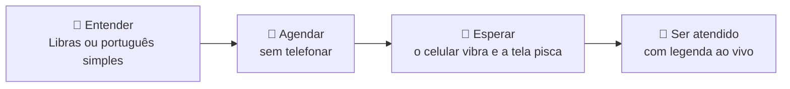
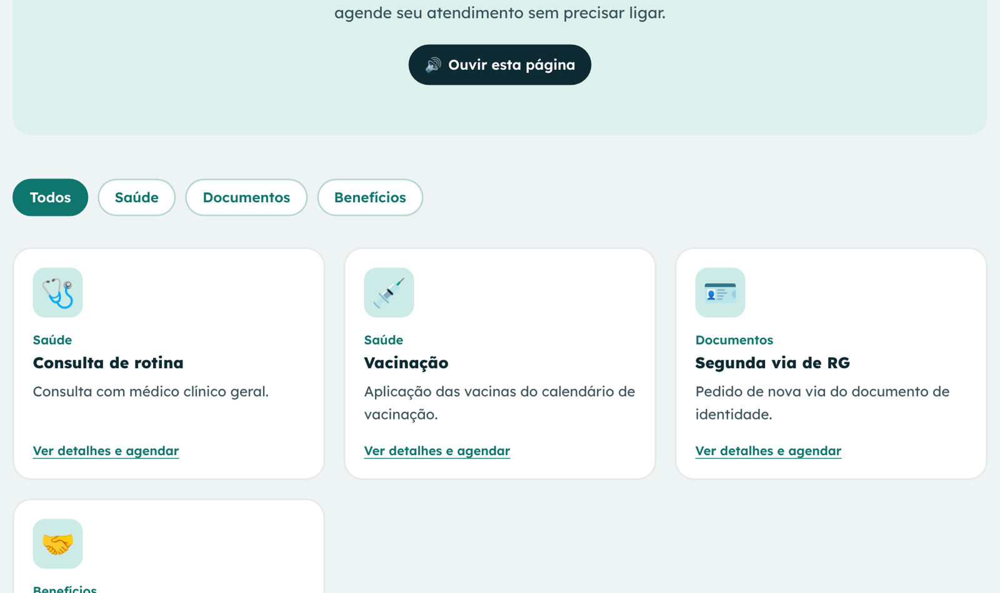
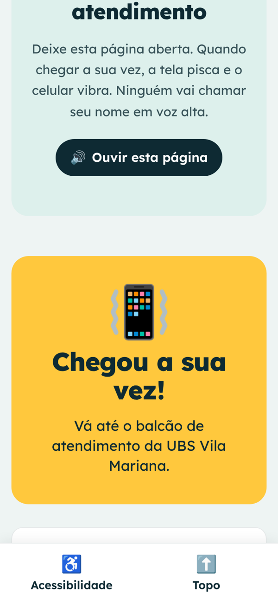
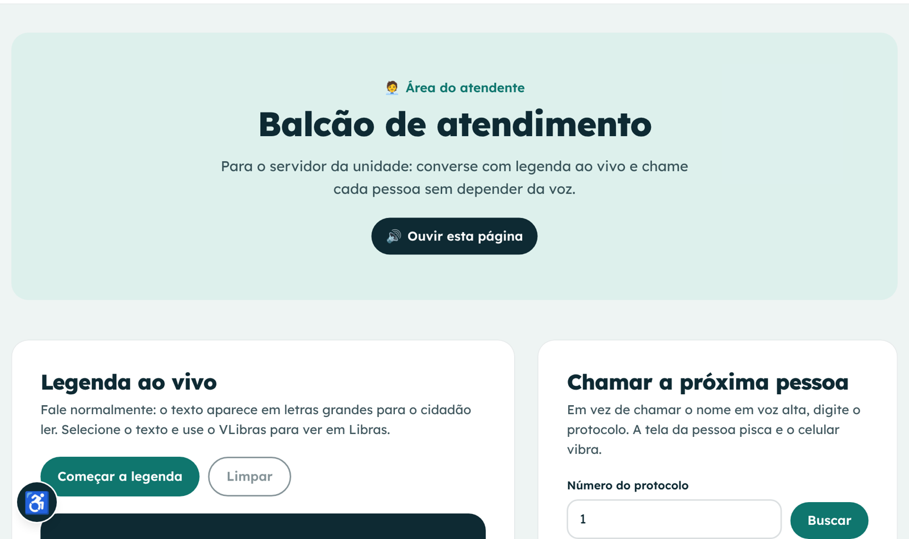

<p align="center">
  
</p>

<p align="center">
  <strong>O serviço público, sem depender de ouvir.</strong><br />
  Global Solution 2026/2 · CitizenTech · FIAP · Equipe Inova Lab · Turma 1TDSR
</p>

<p align="center">
  <a href="https://projeto-ecoa-global-solution.vercel.app"></a>
  <a href="https://ecoamais-api.onrender.com/servicos"></a>
</p>

<p align="center">
  
  
  
  
  
</p>

---

## 💬 Sobre o projeto

O **Ecoa+** torna o atendimento em serviços públicos acessível para **pessoas surdas e com deficiência auditiva**, do começo ao fim: entender o serviço, agendar, esperar a vez e conversar com o atendente.

> **Inclusão não é sobre se adaptar ao mundo. É sobre construir um mundo que considere todas as pessoas.**

<p align="center">
  
</p>

## 🚧 O problema

O atendimento público ainda depende de ouvir:

- 📞 o agendamento costuma ser feito por **telefone**;
- 📢 na sala de espera, o **nome é chamado em voz alta**;
- 😷 no balcão, o atendente fala **atrás de um vidro ou de máscara**, o que impede a leitura labial;
- 📄 as informações vêm em **português difícil**, que nem sempre é a primeira língua de quem usa Libras.

Com isso, a pessoa perde a vez, depende de alguém para acompanhá-la ou desiste do serviço.

## 👥 Para quem é

| 🤟 Pessoas surdas | 👂 Deficiência auditiva | 👵 Perda auditiva com a idade |
| --- | --- | --- |
| Que se comunicam em Libras. | Que usam aparelho auditivo e fazem leitura labial. | Que passaram a ouvir menos ao longo da vida. |

**Roadmap:** fase 2, pessoas com deficiência motora; fase 3, pessoas cegas, não alfabetizadas e em situação de vulnerabilidade.

## ✨ Como funciona



| | Funcionalidade |
| --- | --- |
| 🔎 | **Entender o serviço:** tradução para Libras com o VLibras, textos em português simples e checklist dos documentos que precisam ser levados. |
| 📅 | **Agendar sem telefonar:** escolha do serviço, da unidade, do dia e do horário pelo site. |
| 📳 | **Ser avisado na hora:** na página de acompanhamento, a tela pisca, o celular vibra e o título da aba muda quando o atendente chama. |
| 💬 | **Conversar no balcão:** a fala do atendente aparece em legenda ao vivo, em letras grandes. |
| ♿ | **Acessibilidade:** aumento da letra, alto contraste, leitura da página em voz alta, navegação por teclado e textos para leitores de tela. |

## 📸 Telas

<table>
  <tr>
    <td width="62%"></td>
    <td rowspan="2" align="center"></td>
  </tr>
  <tr>
    <td></td>
  </tr>
  <tr>
    <td align="center"><sub>Serviços vindos da API e o balcão do atendente</sub></td>
    <td align="center"><sub>O aviso de “Chegou a sua vez!” no celular</sub></td>
  </tr>
</table>

## 🛠️ Tecnologias

| Tecnologia | Uso no projeto |
| --- | --- |
| React 19 + Vite | Base da aplicação (SPA) |
| TypeScript | Tipagem dos dados e dos componentes |
| Tailwind CSS 4 | Estilo e layout responsivo |
| React Router 7 | Rotas estáticas e rotas com parâmetro |
| Fetch API | Comunicação com a API Java (sem bibliotecas externas) |
| Web Speech API | Legenda ao vivo e leitura em voz alta |
| Vibration API | Aviso por vibração no celular |
| VLibras | Tradução de português para Libras (governo federal) |
| Vercel | Publicação do front-end |

## 🔌 Integração com a API Java

O front conversa com a API Java publicada no Render, sempre com `fetch`:

| Método | Endpoint | Onde é usado |
| --- | --- | --- |
| `GET` | `/servicos` e `/servicos/{id}` | Lista e detalhe dos serviços |
| `GET` | `/unidades?servicoId={id}` e `/unidades/{id}` | Unidades que oferecem o serviço |
| `POST` | `/cidadaos` | Cadastro do cidadão no agendamento |
| `POST` | `/cidadaos/{id}/atendimentos` | Criação do atendimento (responde `409` se o horário estiver ocupado) |
| `GET` | `/atendimentos/{id}` | Acompanhamento, atualizado a cada 5 segundos |
| `PUT` | `/atendimentos/{id}` | Balcão chamando a pessoa (status `CHAMADO`) |

## 📁 Estrutura do projeto

```
src/
├── components/   # Partes reutilizáveis: cabeçalho, rodapé, botões, cartões e avisos
├── data/         # Conteúdo fixo: integrantes, FAQ e ícones
├── hooks/        # Lógica reutilizável: leitura em voz alta e reconhecimento de fala
├── pages/        # Uma página para cada rota
├── services/     # Chamadas à API Java com fetch
├── types/        # Tipos TypeScript dos dados da API
├── utils/        # Funções de apoio: datas e atalhos
├── App.tsx       # Definição das rotas
├── main.tsx      # Ponto de entrada da aplicação
└── index.css     # Tema do Tailwind, cores e animações
public/           # Favicon e fotos das integrantes
docs/img/         # Imagens deste README
```

## 🗺️ Rotas

| Rota | Página |
| --- | --- |
| `/` | Início |
| `/solucao` | Como a solução funciona |
| `/servicos` | Lista de serviços com filtro por categoria |
| `/servicos/:id` | Detalhe do serviço e documentos necessários |
| `/agendar/:servicoId` | Formulário de agendamento |
| `/atendimento/:id` | Acompanhamento e aviso de "Chegou a sua vez!" |
| `/balcao` | Painel do atendente com legenda ao vivo |
| `/sobre` | Sobre o projeto |
| `/integrantes` | Equipe |
| `/faq` | Perguntas frequentes |
| `/contato` | Formulário de contato |

## 👩‍💻 Integrantes

<table>
  <tr>
    <td align="center" width="25%">
      <br />
      <strong>Bianca Pereira da Silva</strong><br />
      <sub>RM571077 · Back-end Java</sub><br /><br />
      <a href="https://github.com/biancapereirasilva"></a>
      <a href="https://www.linkedin.com/in/bianca-pereira-866845213/"></a>
    </td>
    <td align="center" width="25%">
      <br />
      <strong>Isabelle Souza Lima Pires Araujo</strong><br />
      <sub>RM569370 · Banco de dados e IA</sub><br /><br />
      <a href="https://github.com/isasouzz"></a>
      <a href="https://www.linkedin.com/in/isabelle-souza-9342a027a/"></a>
    </td>
    <td align="center" width="25%">
      <br />
      <strong>Maria Eduarda Cavallari Quarelo</strong><br />
      <sub>RM570462 · Python e Software Engineering</sub><br /><br />
      <a href="https://github.com/dudaquarelo"></a>
      <a href="https://www.linkedin.com/in/dudaquarelo/"></a>
    </td>
    <td align="center" width="25%">
      <br />
      <strong>Thays Lira de Oliveira</strong><br />
      <sub>RM568799 · Front-end</sub><br /><br />
      <a href="https://github.com/thaylira2026-hub"></a>
      <a href="https://www.linkedin.com/in/thays-lira-538619186/"></a>
    </td>
  </tr>
</table>

## ▶️ Como executar

Pré-requisito: [Node.js](https://nodejs.org) 20 ou mais recente.

```bash
# 1. Clonar o repositório
git clone https://github.com/thaylira2026-hub/projeto-ecoa-global-solution.git
cd projeto-ecoa-global-solution

# 2. Instalar as dependências
npm install

# 3. Configurar a URL da API Java
cp .env.example .env
# abra o arquivo .env e preencha: VITE_API_URL=https://ecoamais-api.onrender.com

# 4. Rodar em modo de desenvolvimento
npm run dev
```

O site abre em `http://localhost:5173`. Para gerar a versão de produção: `npm run build`.

> ℹ️ A API está no plano gratuito do Render, que "dorme" sem uso. A primeira consulta pode levar até 1 minuto.

## 🔗 Links

<p align="center">
  <a href="https://projeto-ecoa-global-solution.vercel.app"></a>
  <a href="https://github.com/thaylira2026-hub/projeto-ecoa-global-solution"></a>
  <a href="https://ecoamais-api.onrender.com/servicos"></a>
  
</p>

## 🤖 Uso de inteligência artificial

A equipe usou o Claude (Anthropic) como apoio no front-end: para gerar e revisar partes do código, explicar conceitos, encontrar erros e sugerir melhorias de acessibilidade. O código sugerido foi revisado, testado nas três resoluções e ajustado pela equipe antes de entrar no projeto.

## 💚 Agradecimento

Os textos e a experiência do site foram revisados com a colaboração da **Fran**, que tem deficiência auditiva, usa aparelho auditivo e se comunica pela leitura labial.

## 📬 Contato

- E-mail: ecoa.inovalab@gmail.com
- Formulário: página [Contato](https://projeto-ecoa-global-solution.vercel.app/contato) do site

---

<p align="center">
  Feito pela equipe <strong>Inova Lab</strong> · FIAP · Global Solution 2026/2<br />
  <em>Toda pessoa tem uma voz. Todo espaço pode ser mais inclusivo.</em>
</p>